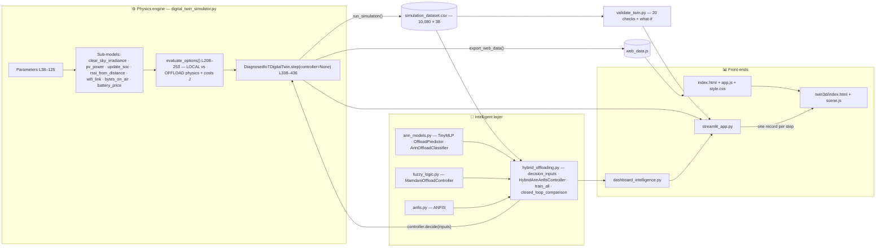
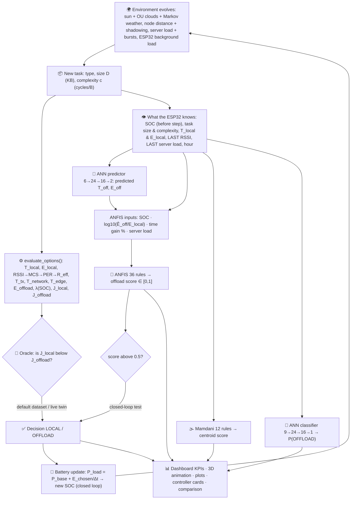

# 🎓 Project Methodology Review — Renewable-Aware IoT Task Offloading with a Digital Twin + ANN + Fuzzy Logic + ANFIS

> **Course:** Fundamentals of Soft Computing  **Repository:** `digital_twin_task_offloading` (branch `claude/zen-brown-non6xo`, HEAD `d10456e`)
>
> **How this file was made.** Every source file was read in full. All numbers below come from the code or from running it
> (read-only: no repo file was changed, no bytecode was written, and the extra experiments wrote their output only to a temporary scratch folder).
> Citations look like `file.py › function()` with line numbers (`L12–30`). Where something is unclear or inconsistent, the file says so.

---

## 📑 Table of Contents

- [0 · The project in 30 seconds](#0--the-project-in-30-seconds)
- [PHASE 1 — Map the project](#phase-1--map-the-project)
  - [1.1 Every file and folder](#11-every-file-and-folder)
  - [1.2 How the project evolved (git history + reports)](#12-how-the-project-evolved-git-history--reports)
  - [1.3 Entry points, how to run, dependencies](#13-entry-points-how-to-run-dependencies)
  - [1.4 Architecture diagrams (mermaid)](#14-architecture-diagrams-mermaid)
- [PHASE 2 — Problem definition](#phase-2--problem-definition)
  - [2.1 What is being solved](#21-what-is-being-solved)
  - [2.2 System parameters and physical models](#22-system-parameters-and-physical-models)
- [PHASE 3 — Soft-computing components, in data-flow order](#phase-3--soft-computing-components-in-data-flow-order)
  - [3.0 The single worked example used everywhere (task T09206)](#30-the-single-worked-example-used-everywhere-task-t09206)
  - [3.1 Digital twin simulation](#31-digital-twin-simulation)
  - [3.2 The oracle cost function (teacher)](#32-the-oracle-cost-function-teacher)
  - [3.3 ANN #1 — Offload predictor (regression)](#33-ann-1--offload-predictor-regression)
  - [3.4 ANN #2 — "ANN only" classifier (baseline)](#34-ann-2--ann-only-classifier-baseline)
  - [3.5 Mamdani fuzzy controller ("Fuzzy only" baseline)](#35-mamdani-fuzzy-controller-fuzzy-only-baseline)
  - [3.6 ANFIS (5-layer neuro-fuzzy)](#36-anfis-5-layer-neuro-fuzzy)
  - [3.7 The hybrid ANN → ANFIS controller](#37-the-hybrid-ann--anfis-controller)
- [PHASE 4 — Integration & decision making](#phase-4--integration--decision-making)
  - [4.1 How the final decision is made](#41-how-the-final-decision-is-made)
  - [4.2 Dashboard and visualisation layer](#42-dashboard-and-visualisation-layer)
- [PHASE 5 — Results & evaluation](#phase-5--results--evaluation)
  - [5.1 Metrics, baselines and actual numbers](#51-metrics-baselines-and-actual-numbers)
  - [5.2 Strengths, limitations, assumptions, future work](#52-strengths-limitations-assumptions-future-work)
  - [5.3 Small inconsistencies to know before the review](#53-small-inconsistencies-to-know-before-the-review)
- [PHASE 6 — Review preparation](#phase-6--review-preparation)
  - [6.1 Five-minute spoken walkthrough](#61-five-minute-spoken-walkthrough)
  - [6.2 25 likely reviewer questions with crisp answers](#62-25-likely-reviewer-questions-with-crisp-answers)
  - [6.3 One-page cheat sheet](#63-one-page-cheat-sheet)

---

## 0 · The project in 30 seconds

Every simulated minute, an IoT monitoring task (sensor data to process) arrives at a **solar-powered ESP32**. It can be
**run locally** on the ESP32 or **offloaded over WiFi (MQTT) to an edge server**. A **digital twin** (a physics-based
simulator of the PV panel, battery, ESP32, WiFi link and edge server) computes the true time and energy of both options.

- The **exact** cost comparison (the *oracle*) needs facts the real ESP32 **cannot know before sending**: the real latency, the radio energy, the current server load.
- So three **soft-computing controllers** decide with only what the node knows, and they are graded against the oracle:
  1. 🌫️ **Fuzzy only**: a hand-written Mamdani controller (12 rules)
  2. 🧠 **ANN only**: an MLP classifier (black box)
  3. ⭐ **ANN + ANFIS**: an ANN *predicts* the offload time and energy, then an ANFIS (36 learned fuzzy rules) *reasons* about them → accurate **and** explainable.

> ⚠️ **Scope note for reviewers.** There are **two** execution nodes: **local (ESP32)** and **edge server**. There is **no cloud tier** in the code.
> If asked, say that adding a cloud tier is future work (§5.2).

---

# PHASE 1 — Map the project

## 1.1 Every file and folder

| Path | Lines | One-line purpose |
|---|---:|---|
| `digital_twin_simulator.py` | 474 | **The only physics engine**: all parameters, sub-models, the stateful twin `DiagnosedIoTDigitalTwin`, and dataset generation |
| `validate_twin.py` | 154 | 20 engineering checks (Spearman correlations, energy balance, continuity) + a SOC × RSSI "what-if" table |
| `ann_models.py` | 199 | NumPy MLP `TinyMLP` (Adam, backprop), the `OffloadPredictor` regressor and the `AnnOffloadClassifier` |
| `fuzzy_logic.py` | 143 | Trapezoid/triangle membership functions, 4 linguistic inputs, 12 expert rules, `MamdaniOffloadController` |
| `anfis.py` | 164 | Generic 5-layer first-order Sugeno `ANFIS` with hybrid learning (ridge least squares + gradient descent) |
| `hybrid_offloading.py` | 257 | Decision-time inputs, the `HybridAnnAnfisController`, `train_all()`, the closed-loop comparison, CLI report |
| `dashboard_intelligence.py` | 375 | Streamlit section for the intelligent layer (live cards, 4 tabs of charts) + the always-visible explanation |
| `streamlit_app.py` | 315 | **Main dashboard**: controls, KPIs, 3D twin component, 8 relationship plots, verification, dataset download |
| `index.html` | 556 | Stand-alone web viewer: Architecture SVG, 3D Twin, Data Flow and Module Reference views |
| `app.js` | 359 | Web-viewer logic (**playback only, no physics**): reads `web_data.js` and updates the views |
| `style.css` | 681 | Styles for the web viewer (dark theme; last commit added a muted "industrial" palette override) |
| `web_data.js` | 2 | The same dataset as JSON (`window.TWIN_DATA = {columns, rows}`), so `index.html` works from `file://` |
| `simulation_dataset.csv` | 10,081 | Generated dataset: 7 days × 1440 min = **10,080 tasks × 38 columns** (seed 42, initial SOC 25 %) |
| `requirements.txt` | 4 | `numpy>=1.21`, `pandas>=1.3`, `plotly>=5.0`, `streamlit>=1.28` |
| `README.md` | 239 | Project documentation: model equations, controller table, typical results |
| `VISUAL_ENHANCEMENT_REPORT.txt` | 81 | Report of the latest 3D visual upgrade and what was (not) changed |
| `VISUAL_PROTECTED_SHA256.json` | 142 | SHA-256 hashes of files that must stay byte-identical (141 entries) |
| `.gitignore` | 3 | Ignores `__pycache__/`, `*.pyc`, notebook checkpoints |
| **`.streamlit/`** | | |
| `.streamlit/config.toml` | 6 | Streamlit dark theme (primary `#8b5cf6`, background `#0b1026`) |
| **`twin3d/`** | | **Shared Three.js 3D scene**, used by both the dashboard and the web viewer |
| `twin3d/scene.js` | 1034 | `createTwinScene()`: outdoor scene (PV, battery cabinet, ESP32, gateway mast, server shelter), driven by one dataset row per step |
| `twin3d/index.html` | 46 | Streamlit custom-component wrapper: builds the scene **once**, then receives new rows via `postMessage` |
| `twin3d/assets/models.js` | 13 | Optional GLB model map (`window.TWIN_GLB_MODELS`); empty by default, so the procedural models are used |
| `twin3d/assets/textures/*.png` | 5 files | Gravel, concrete, galvanised steel, PV cells, soft cloud textures (added in the last commit) |
| `twin3d/vendor/` | 4 files | Bundled Three.js r128, `OrbitControls.js`, `GLTFLoader.js` + MIT `LICENSE` (offline use) |

**Integrity check (read-only).** I recomputed all hashes in `VISUAL_PROTECTED_SHA256.json`. Every protected file still matches once line
endings are normalised to Windows CRLF, which shows the hash file was made on Windows. **Nothing protected has been modified.**

## 1.2 How the project evolved (git history + reports)

| Date | Commit | What changed (from `git log --stat`) |
|---|---|---|
| 2026-10-05 | `d1eb708` *first commit* | Original version: a small `digital_twin_simulator.py` (166 lines), a huge `streamlit_app.py` (1227 lines), two legacy CSVs (`digital_twin_dataset.csv`, `research_digital_twin_dataset.csv`, 43k rows), a scratch physics test, committed `__pycache__` |
| 2026-10-05 | `7ed5612` | README updated |
| 2026-10-05 | `66f956b` (PR #1) **"Rebuild digital twin on physical models with a single Python engine"** | Simulator rewritten with physical models (PV, battery CC/CV, AR(1) tasks, log-distance WiFi + MCS + PER, M/M/1-style edge, battery-priced cost). Added `validate_twin.py` (20 checks), the shared `twin3d/` scene, `.streamlit/config.toml`; `index.html/app.js` became a pure viewer of `web_data.js`. Legacy CSVs, scratch engine and `__pycache__` removed |
| 2026-10-05 | `5e6d288` | Dataset merge conflict resolved with the remote version |
| 2026-10-15 | `3fcc41e` (PR #2) **"Add ANN + fuzzy + ANFIS intelligent offloading layer"** | Added `ann_models.py`, `fuzzy_logic.py`, `anfis.py`, `hybrid_offloading.py`, `dashboard_intelligence.py`; `step()` got the optional `controller` argument (the default is still the oracle, so the dataset is unchanged) |
| 2026-10-15 | `bf1e9f6` | Plotly ≥ 6 fix: 8-digit hex colours → `rgba()` (`dashboard_intelligence.py › hex_to_rgba()` L75–78) |
| 2026-10-25 | `d10456e` *"feat: altering digital twin simulation"* | **Visual only**: outdoor 3D scene (`scene.js` +605 lines), 5 textures, presentation CSS in `streamlit_app.py`/`style.css`, a UTF-8 stdout fix in `validate_twin.py`, the report + hash file. The CSV diff is line endings only: the regenerated data is identical (see below) |

**What `VISUAL_ENHANCEMENT_REPORT.txt` says.** Only visual files changed. The simulation, AI modules, dataset and vendor libraries are
byte-identical to the source ZIP. Seeds 42 and 7 reproduce all 38 columns exactly, and `validate_twin.py` gives 20/20 PASS.
It honestly lists limits: the dataset has no `Task_Outcome` field, so the 3D card says *"Outcome not exported · modeled path"*, and
real-browser/GPU checks were not completed.

**I re-verified reproducibility:** regenerating seed 42 for 10,080 steps (into a scratch folder) gives a CSV that is **text-identical** to the
committed `simulation_dataset.csv` (after line-ending normalisation).

## 1.3 Entry points, how to run, dependencies

| Entry point | What it does | Writes files? |
|---|---|---|
| `python digital_twin_simulator.py` | `run_simulation(n_days=7)` (L452–470): runs the twin with seed 42 and writes `simulation_dataset.csv` + `web_data.js` | ⚠️ **Yes, it overwrites the dataset.** Not needed before the review |
| `python validate_twin.py` | Prints the 20 checks + what-if table (`__main__` L141–154) | No |
| `python hybrid_offloading.py` | Trains everything, prints the ANN quality, the top ANFIS rules and the closed-loop table (L400–421). About 11 s here (training itself 2.9 s) | No |
| `streamlit run streamlit_app.py` | The full live dashboard | Only when you click "Generate 7-day dataset" |
| `index.html` (double-click, or `python -m http.server`) | Web viewer playing back `web_data.js` | No |

**Dependencies:** Python with `numpy`, `pandas` (engine + AI), plus `plotly`, `streamlit` (dashboard). **No ML framework**: the ANN, fuzzy and
ANFIS code is plain NumPy. Three.js r128 is bundled, so the 3D view works offline.

> I ran `validate_twin.py`, `hybrid_offloading.py` and extra analysis scripts. Streamlit/plotly were not installed in my environment,
> so I did **not** launch the dashboard. Its description below comes from reading the code. Test it on your demo laptop.

## 1.4 Architecture diagrams (mermaid)

### Module architecture (who imports/uses whom)



### Data flow for ONE task: input → decision → dashboard



---

# PHASE 2 — Problem definition

## 2.1 What is being solved

**Task offloading** means deciding *where* a computation runs. A weak, battery-powered device either does the work itself (it costs CPU time and
energy) or sends the data to a more powerful machine (it costs radio time and energy, plus network and server delay).

**The physical system modelled** (`digital_twin_simulator.py` docstring L1–26):

```
☀️ SOLAR PV (1 W) → 🔋 BATTERY (12 Wh Li-ion) → 📟 ESP32 (240 MHz) → 📶 WiFi 802.11n / MQTT → 🖥️ EDGE SERVER (3 GHz vCPU)
```

| Node | Role in the code |
|---|---|
| **Local = ESP32** | Executes `C = D·c` cycles at 240 MHz, minus its background load; spends CPU energy |
| **Edge server** | Executes the same cycles at 3 GHz, slowed by its utilisation `U` (`T_edge = C/(f(1−U))`) |
| **Network** | WiFi uplink + result downlink + gateway/broker hop + channel-access queue |
| **Cloud** | ❌ Not modelled |

**Why a digital twin?** A digital twin is a software mirror of a physical system that evolves in time like the real one. Here it:
1. **Generates realistic, labelled training data** (10,080 tasks) without hardware. Every row carries the *true* cost of both options.
2. **Acts as a closed-loop test bench.** A controller's choice changes the battery, and the battery changes the next decision (`step()` L382–386).
3. **Provides the oracle** (perfect-information optimum) to grade realistic controllers.
4. **Gives a visual mirror** (3D scene, live KPIs) for explanation.

**What is optimised.** A single scalar cost `J` per option (`evaluate_options()` L235–244) that combines:
- **Energy**, priced by battery risk `λ(SOC)`: energy becomes "more expensive" as the battery empties.
- **Completion time** relative to the 5 s deadline.
- **Deadline penalty** (+2 if the option would miss 5 s).
- For offloading only: **link reliability risk** (0.3·PER) and **edge congestion risk** (0.3·U²).

The decision is `argmin(J_local, J_offload)` (L252). There are **no thresholds like "solar > 50 % → LOCAL"**. Solar influences decisions
**only through the battery SOC** (README L17–19, L111).

## 2.2 System parameters and physical models

All constants are in `digital_twin_simulator.py` L38–125 (section "1. MODEL PARAMETERS").

### Parameter table (default values)

| Group | Symbol / name in code | Value | Meaning |
|---|---|---|---|
| Time | `DT_S` | 60 s | 1 step = 1 minute |
| Solar | `P_RATED_W`, `G_STC`, `G_CLEAR_PEAK`, `ETA_PV` | 1 W, 1000 W/m², 1000 W/m², 0.85 | Small IoT panel, derating |
| | `SUNRISE_H`, `SUNSET_H` | 6 h, 18 h | Daylight window |
| Weather | `WEATHER_MEAN_K` | Sunny 0.85, Partly Cloudy 0.60, Overcast 0.30 | Mean cloud transmittance |
| | `WEATHER_TRANSITION` | Sunny→[0.60,0.30,0.10], PC→[0.35,0.40,0.25], Overcast→[0.25,0.40,0.35] | Daily Markov chain |
| | `CLOUD_REVERSION`, `CLOUD_SIGMA` | 0.03, 0.03 | OU cloud process |
| Battery | `E_BAT_WH` (`E_BAT_J`) | 12 Wh (43,200 J) | Capacity |
| | `ETA_CHARGE`, `ETA_DISCHARGE` | 0.95, 0.95 | Efficiencies |
| | `CV_TAPER_SOC`, `CV_TAPER_FACTOR` | 90 %, 0.60 | CC/CV taper |
| | `SELF_DISCHARGE_PCT` | 0.0001 %/min | ≈ 4 %/month |
| ESP32 | `F_CPU_HZ` | 240 MHz | Clock |
| | `P_BASE_W` | 0.14 W | Always-on sensors + WiFi association |
| | `P_CPU_IDLE_W`, `ALPHA_CPU_W` | 0.10 W, 0.0012 W/% | CPU power model |
| | `T_DEADLINE_S` | 5 s | Deadline |
| | `BACKGROUND_MEAN` | 12 % | RTOS/WiFi stack load (random walk, clipped 5–30 %) |
| Tasks | `TASK_TYPES` | Sensor Aggregation 60 c/B·40 KB; Signal Filtering 250·80; FFT 800·160; Anomaly Detection 1800·160; Image Preprocessing 3000·300 | Complexity, mean size |
| | `TASK_TYPE_PERSISTENCE` | 0.90 | Next task keeps its type with p = 0.9 |
| | `TASK_SIZE_MIN/MAX_KB`, `RESULT_SIZE_KB` | 4 / 1024 KB, 1 KB | Size limits, result size |
| WiFi | `RSSI_0_DBM`, `D0_M`, `PATH_LOSS_N` | −40 dBm, 1 m, 2.6 | Log-distance model |
| | `SHADOW_SIGMA_DB`, `SHADOW_CORR`, `FAST_FADE_SIGMA_DB` | 4 dB, 0.95, 1.5 dB | Correlated shadowing + fast fading |
| | `DIST_MEAN/MIN/MAX_M` | 18 / 3 / 40 m | Node on moving equipment |
| | `MCS_TABLE` | MCS7 65 Mbps @ −72 dBm … MCS0 6.5 Mbps @ −91 dBm | 802.11n HT20 rate adaptation |
| | `ETA_MAC` | 0.35 | PHY → application throughput |
| | `PER_SLOPE`, `RETRY_LIMIT` | 0.7 /dB, 7 | Packet errors, max attempts |
| | `MSS_BYTES`, `HEADER_BYTES_PER_SEG`, `MQTT_HEADER_BYTES` | 1460, 40, 20 B | Protocol overhead |
| | `T_GATEWAY_S`, `T_CONTENTION_S` | 3 ms, 4 ms | Broker hop, base channel access |
| | `P_TX_W`, `P_RX_W` | 0.60 W, 0.33 W | Radio TX/RX power |
| Edge | `F_EDGE_HZ`, `SERVER_LOAD_MAX`, `BURST_PROBABILITY` | 3 GHz, 97 %, 0.02 /step | Capacity, cap, bursts |
| Cost | `E_REF_J`, `K_BATTERY_RISK` | 1 J, 4 | Energy normaliser, battery-risk gain |
| | `W_ENERGY`, `W_TIME`, `W_NETWORK`, `W_SERVER`, `W_DEADLINE` | 1, 1, 0.3, 0.3, 2 | Cost weights |

### Physical equations (with code location)

**Solar** (`clear_sky_irradiance()` L131–136, `pv_power()` L139–141, `_update_clouds()` L291–295, `_update_weather()` L285–289)
```
G_clear(h) = 1000 · sin(π·(h − 6)/12)          for 6 < h < 18, else 0          [W/m²]
k ← k + 0.03·(k̄_weather − k) + N(0, 0.03),  clipped to [0.05, 1]               (Ornstein–Uhlenbeck)
G = G_clear · k ;   P_PV = P_rated · G / G_STC · η_PV  = 1 · G/1000 · 0.85       [W]
```
Weather is redrawn at midnight from the Markov matrix.

**Battery** (`update_soc()` L144–164; load in `step()` L383–386)
```
P_load = P_base + E_task_chosen / Δt
P_net  = P_PV − P_load
P_charge = max(0, P_net) (×0.6 if SOC ≥ 90 %, 0 if SOC ≥ 100 %) ;  P_dis = max(0, −P_net)
ΔSOC[%] = 100·( η_c·P_charge·Δt/E_bat − P_dis·Δt/(η_d·E_bat) ) − 0.0001 ;  SOC clipped to [0, 100]
```

**Task generation** (`_new_task()` L318–335)
```
with p = 0.1 the type is redrawn uniformly (it may stay the same)
activity = 0.7 + 0.3·sin(π(h − 6)/14) for 6 < h < 20, else 0.7
s ← 0.9·s + N(0, 0.12)                      (AR(1) log-size deviation)
D [KB] = mean_kb · activity · e^s, clipped to [4, 1024]
c [cycles/B] = base_c · e^{N(0, 0.08)}
C_required = D·1024 · c                     [cycles]
```

**ESP32 local execution** (`evaluate_options()` L218–221; background L359–360)
```
CPU_Load = min(100, Background + 100·C/(f_ESP32·T_deadline))         [%]
T_local  = C / (f_ESP32 · (1 − Background/100))                       [s]
E_local  = (P_idle + α·CPU_Load) · T_local = (0.10 + 0.0012·CPU_Load)·T_local    [J]
```

**WiFi link** (`_update_position()` L297–303, `rssi_from_distance()` L167–169, `wifi_link()` L172–188, `bytes_on_air()` L191–194, `wifi_channel_utilisation()` L202–205)
```
d ← d + 0.005·(18 − d) + N(0, 0.8), clipped to [3, 40] m
X_shadow ← 0.95·X + N(0, 4·√(1 − 0.95²))          (Gudmundson correlated shadowing)
RSSI = −40 − 10·2.6·log10(d/1) + X_shadow + N(0, 1.5)         [dBm]
MCS  = fastest entry with RSSI ≥ sensitivity (fallback MCS0)
PER  = 1 / (1 + 9·e^{0.7·(RSSI − sensitivity)})   (= 10 % exactly at sensitivity)
N_tx = min(1/(1 − PER), 7)
U_ch = 0.15 + 0.35·sin(π(h − 7)/14) for 7 < h < 21, else 0.15
R_eff = R_MCS · 0.35 · (1 − U_ch) / N_tx                          [bit/s]
bytes_on_air(B) = B + 20 + ceil((B + 20)/1460)·40
T_tx = bytes_on_air(D)·8 / R_eff ;  T_result = bytes_on_air(1 KB)·8 / R_eff
T_queue = U_ch/(1 − U_ch) · 0.004 ;   T_network = T_tx + T_result + 0.003 + T_queue
```

**Edge server** (`_update_server_load()` L305–315; `evaluate_options()` L230–233)
```
target = 15 + 55·sin(π(h − 7)/14) (office hours, else 15)
base ← base + 0.05(target − base) + N(0, 2), clipped [5, 90];  burst ← 0.85·burst (+U(15,30) with p = 0.02)
U = min(97, base + burst)                                       [%]
T_edge = C / (f_edge · (1 − U/100))                             (M/M/1 sojourn form)
T_offload = T_network + T_edge
E_offload = P_tx·T_tx + P_rx·(T_edge + T_result + T_gateway + T_queue)     [J]
```

**Cost / decision (the oracle)** (`battery_price()` L197–199, `evaluate_options()` L235–252)
```
λ(SOC) = 1 + 4·(1 − SOC/100)^1.5
J_local   = λ·E_local/E_ref   + T_local/T_dl   + 2·[T_local > T_dl]
J_offload = λ·E_offload/E_ref + T_offload/T_dl + 0.3·PER + 0.3·(U/100)² + 2·[T_offload > T_dl]
Decision  = LOCAL if J_local < J_offload else OFFLOAD
```

**Dataset ranges (measured from `simulation_dataset.csv`):** SOC 15.2 – 57.4 % (mean 32.0 %); task size 14 – 654 KB (median 105);
local time 3.7 ms – 10.6 s (median 482 ms); RSSI −93.6 to −40.8 dBm (median −71); MCS7 used in 56 % of tasks; server load 5 – 97 %
(median 33); offload total time 10.7 ms – 4.4 s (median 128 ms). Decisions: **54.0 % LOCAL / 46.0 % OFFLOAD**. Offload share by type:
Sensor Aggregation 0 %, Signal Filtering 0 %, FFT 48.5 %, Anomaly Detection 85 %, Image Preprocessing 99.4 %. Weather over the 7 days:
PC, PC, PC, PC, Overcast, Sunny, Sunny.

---

# PHASE 3 — Soft-computing components, in data-flow order

## 3.0 The single worked example used everywhere (task T09206)

One real row from the **validation days** (never used for training) is traced through every stage. All values were checked both by hand and by running the code.

| Field | Value | Field | Value |
|---|---|---|---|
| Timestamp | Day 07, 09:26 (h = 9.433), Sunny | Task | Anomaly Detection |
| Task_Size D | 213.74 KB | Complexity c | 1660.6 cycles/B |
| Background load | 17.13 % | Distance / RSSI | 7.37 m / −62.01 dBm |
| Server load U | 48.97 % | SOC before step | 33.5485 % |
| *Last* RSSI (known) | −68.78 dBm | *Last* server load (known) | 49.37 % |
| G / P_PV | 618.8 W/m² / 0.526 W | Oracle decision | **OFFLOAD** |

A second, simpler example appears at the end of §3.7: **T09001**, a Sensor Aggregation task that every controller sends LOCAL.

---

## 3.1 Digital twin simulation

**a. Why this technique.** Soft computing needs data, and offloading has no clean closed-form optimum under uncertainty. The twin is
the *data source and the testing ground*. It uses **stochastic but physically meaningful processes** (OU clouds, Markov weather, AR(1)
task sizes, correlated shadowing, mean-reverting distance and load) so the data has realistic noise and temporal continuity. It
deliberately never adds noise to costs or decisions (docstring L19–20). That keeps the labels consistent, which is what supervised learning needs.

**b. Inputs / outputs.** Inputs: `seed` (42 for the dataset, 7 for testing) and `initial_soc` (25 %) (`__init__` L262–282), plus an
optional `controller`. Output per `step()`: a dict of 38 columns (L389–433), plus `Oracle_Decision` when a controller is used (L434–435).

**c. Step by step (`DiagnosedIoTDigitalTwin.step()` L338–436):**
1. Advance the clock: `tick += 1`, `hour = (tick mod 1440)/60` (L344–347).
2. Renewable: update the weather (midnight) and clouds, compute `G` and `P_PV` (L350–353).
3. New task: type, size, complexity (L356).
4. Update the ESP32 background load, node distance/shadowing → RSSI, channel utilisation, server load (L359–364).
5. `evaluate_options()` computes both options' physics and costs (L367–368).
6. Decide: the oracle (default) **or** `controller.decide()` with decision-time info only: SOC, task, local time/energy, **last** RSSI, **last** server load (L369–380).
7. Battery update with the energy of the **chosen** option (closed loop) (L383–386).
8. Return the rounded record (times in ms, energies in mJ) (L389–436).

**d. Worked example (T09206), by hand:**

| Quantity | Calculation | Result |
|---|---|---|
| C | 213.74·1024 B × 1660.6 | **363.45 Mcycles** |
| CPU_Load | 17.13 + 100·363.45e6/(240e6·5) = 17.13 + 30.29 | **47.42 %** |
| T_local | 363.45e6 / (240e6·(1−0.1713)) | **1.8274 s** |
| E_local | (0.10 + 0.0012·47.42)·1.8274 = 0.1569·1.8274 | **0.2867 J** |
| MCS | −62.01 ≥ −72 → MCS7, 65 Mbps, margin 9.99 dB | MCS7 |
| PER, N_tx | 1/(1+9e^{0.7·9.99}) | 1.0e-4, 1.0001 |
| U_ch | 0.15 + 0.35·sin(π·2.433/14) | 0.3318 |
| R_eff | 65e6·0.35·(1−0.3318)/1.0001 | **15.20 Mbps** |
| Bytes on air | 218,870 + 20 + 150 segments·40 | 224,890 B |
| T_tx | 224,890·8 / 15.20e6 | **118.4 ms** |
| T_network | 118.4 + 0.57 (result) + 3 (gateway) + 1.99 (queue) | **123.9 ms** |
| T_edge | 363.45e6/(3e9·(1−0.4897)) | **237.4 ms** |
| T_offload | 123.9 + 237.4 | **361.3 ms** |
| E_offload | 0.6·0.1184 + 0.33·(0.2374+0.00057+0.003+0.00199) | 0.0710 + 0.0802 = **0.1512 J** |
| Battery | P_load = 0.14 + 0.1512/60 = 0.1425 W; P_net = 0.526 − 0.1425 = 0.3835 W → ΔSOC = 100·0.95·0.3835·60/43200 − 0.0001 | **+0.0505 %/min** ✓ (CSV: 0.0505) |

**e. How it feeds the next stage.** The twin's 10,080 rows become (i) the ANN training data, (ii) the oracle labels and soft
preferences, and (iii) through `step(controller)`, the closed-loop evaluation environment.

---

## 3.2 The oracle cost function (teacher)

**a. Why.** The oracle is not a soft-computing method. It is the **ground truth / teacher**. It decides with perfect information, which no real
device has. That is exactly why approximate reasoning (ANN, fuzzy) is needed.

**b. Inputs/outputs.** Inputs: the true energies, times, PER, U and SOC. Output: `J_local`, `J_offload`, decision.

**c. Key design idea.** `λ(SOC)` multiplies **both** energies (the README calls this out at L107–111). As a result:
- low SOC + good link → offloading saves energy → OFFLOAD more attractive;
- low SOC + poor link → retransmissions make the radio cost more than the CPU → LOCAL more attractive.

This interaction is proven by `validate_twin.py › what_if_battery_network()` (L122–138). The table shows ΔJ = J_local − J_offload for an Anomaly Detection task (160 KB, server 40 %):

| SOC \ RSSI | −55 | −65 | −72 | −80 | −86 | −90 |
|---|---|---|---|---|---|---|
| 10 % | 0.597 | 0.597 | 0.540 | 0.361 | −0.087 | **−1.729** |
| 50 % | 0.408 | 0.408 | 0.363 | 0.259 | −0.000 | −0.944 |
| 90 % | 0.287 | 0.287 | 0.249 | 0.193 | 0.056 | −0.439 |

Read across a row: as the signal gets weaker, offloading loses its advantage. Read down a column: with a good link a lower SOC favours offloading
even more, and with a poor link a lower SOC favours local.

**d. Worked example (T09206):** λ = 1 + 4·(1 − 0.335485)^1.5 = **3.1668**
`J_local = 3.1668·0.28673 + 1.8274/5 = 0.9080 + 0.3655 = 1.2735`
`J_offload = 3.1668·0.15119 + 0.36132/5 + 0.3·0.0001 + 0.3·0.4897² = 0.4788 + 0.0723 + 0.00003 + 0.0719 = 0.6230`
→ J_offload < J_local → **OFFLOAD** (CSV: 1.27347 / 0.62303 ✓).

**e. Feeds:** (1) the hard label `Oracle_Offload` (ANN classifier target, accuracy reference) and (2) the soft label
`Offload_Preference = 0.5 + 0.5·tanh((J_local − J_offload)/0.25)` (ANFIS target) (`hybrid_offloading.py › decision_inputs()` L235–236).
For T09206: 0.5 + 0.5·tanh(0.6504/0.25) = 0.5 + 0.5·tanh(2.602) = **0.9945**.

---

## 3.3 ANN #1 — Offload predictor (regression)

**a. Why an ANN.** The chain *last RSSI → MCS → PER → retransmissions → goodput → latency/energy* and *server load → 1/(1−U)* is strongly
**non-linear, piecewise (MCS steps) and noisy** (the RSSI actually experienced differs from the last measured one). An MLP is a universal function
approximator that learns this from examples without hand-written equations (`dashboard_intelligence.py` explanation L310–311). It turns
**unknown** quantities into **predicted** ones.

**b. Inputs and outputs** (`ann_models.py › network_features()` L129–139, `OffloadPredictor` L145–166)

| # | Input | Transform | Why |
|---|---|---|---|
| 1 | Task_Size [KB] | ln | spans 4 KB … 1 MB |
| 2 | Task_Complexity [c/B] | ln | drives edge time |
| 3 | Last_RSSI [dBm] | raw | link quality known before sending |
| 4 | Last_Server_Load [%] | raw | last load the edge reported |
| 5–6 | Hour | sin(2πh/24), cos(2πh/24) | cyclic time of day (WiFi busier by day) |

Then every input is **z-score standardised** inside `TinyMLP.fit()` (L72–77). **Outputs (2):** ln(Offload_Total_Time [ms]) and
ln(Offload_Energy [mJ]), also standardised during training (L73–74). `predict()` returns `exp()` of the outputs (L163–166).
Log targets mean the network learns **ratios** (relative error), which suits values that span 10 ms to 4 s.

**c. Internal working** (`TinyMLP` L29–118)

| Item | Value | Code |
|---|---|---|
| Architecture | **6 → 24 → 16 → 2** (602 parameters) | `OffloadPredictor.__init__` L148–149 |
| Hidden activation | tanh | `_forward()` L54–55 |
| Output activation | linear (regression) | L58–59 |
| Loss | Mean squared error (on standardised log targets) | `_loss()` L62–66 |
| Initialisation | W ~ N(0, √(1/fan_in)), b = 0 (code comment says "Xavier"; strictly this is LeCun-normal) | L43–44 |
| Optimiser | **Adam** β1 = 0.9, β2 = 0.999, ε = 1e-8, lr = 0.01, bias-corrected | L80–107 |
| Mini-batch | 128, reshuffled every epoch (seed 0) | L86–89 |
| Epochs | 60 (`train_all(epochs=60)`) | `hybrid_offloading.py` L314, L323 |
| Backprop | output error δ = (ŷ − y)/batch; δ ← (δ·Wᵀ)·(1 − a²) for tanh | L92–100 |

**Training data.** `decision_inputs()` turns the CSV into decision-time inputs (`hybrid_offloading.py` L211–237). Last_RSSI and Last_Server_Load
are `shift(1)` of the dataset columns, and SOC is the stored SOC minus `dSOC_dt` (the dataset stores SOC *after* the step). The split is
**chronological 80/20**: 8,064 training rows (days 1–5.6), 2,016 validation rows (last 1.4 days) (L319–320). No shuffling across the split,
so there is no future-to-past leakage.

**Results** (my run, identical to the README): validation **R² (log space) = 0.989 for time, 0.987 for energy**; median absolute
percentage error **5.2 % (time), 5.6 % (energy)**. The loss fell from 0.047 to 0.0148 (train) and ended at 0.0113 (validation).

**d. Worked example (T09206).** Inputs: ln(213.74) = 5.365, ln(1660.6) = 7.415, −68.78 dBm, 49.37 %, sin/cos(2π·9.433/24) = (0.623, −0.782).
The ANN predicts **T̂_off = 353.5 ms** (real 361.3 → −2.2 %) and **Ê_off = 149.4 mJ** (real 151.2 → −1.2 %). The prediction is accurate
even though the *last* RSSI (−68.8) differs from the actual RSSI (−62.0).

**e. Feeds:** T̂_off and Ê_off become two of the four ANFIS inputs (§3.7).

---

## 3.4 ANN #2 — "ANN only" classifier (baseline)

**a. Why.** It is the natural black-box baseline: "Can one network learn the decision directly?"

**b. I/O** (`AnnOffloadClassifier` L172–199): **9 inputs** = the 6 network features + SOC + ln(Local_Exec_Time) + ln(Local_Energy).
Output: P(OFFLOAD) ∈ (0, 1). Decision: OFFLOAD if P > 0.5 (L198–199).

**c. Internals:** the same `TinyMLP`, **9 → 24 → 16 → 1** (657 parameters), tanh hidden, **sigmoid** output, **binary cross-entropy** loss
(L57, L63–65), Adam lr 0.01, batch 128, 60 epochs, seed 1. Target: the hard oracle label `Oracle_Offload` (0/1).
Training BCE went from 0.079 to 0.049 (validation 0.045).

**d. Worked example (T09206):** P(OFFLOAD) = **0.99975** → OFFLOAD (correct). It cannot say *why*.

**e. Feeds:** only the comparison and the dashboard cards. It is not part of the hybrid.

---

## 3.5 Mamdani fuzzy controller ("Fuzzy only" baseline)

**a. Why fuzzy logic.** Engineers describe offloading in vague words: "battery fairly low, signal okay, server a bit busy" (`fuzzy_logic.py`
docstring L4–6). Fuzzy logic turns those words into graded memberships and IF–THEN rules, so it is **fully explainable** and needs **no
training data**. Its weakness: the thresholds are expert guesses, and it does not know the real offload cost.

**b. Inputs/outputs (crisp ranges)** (`FUZZY_INPUTS` L263–281, `FUZZY_OUTPUT` L283–286). No normalisation: the sets are defined on raw units.

| Linguistic variable (key) | Range | Fuzzy sets: type (parameters) |
|---|---|---|
| **Battery SOC** (`SOC`) [%] | 0–100 | Low: trap(0, 0, 20, 35) · Medium: tri(20, 40, 60) · High: trap(45, 65, 100, 100) |
| **Task load** (`Local_Exec_Time`) [ms] | 1–20000 (log axis in plots) | Light: trap(0, 0, 150, 300) · Medium: trap(150, 350, 800, 1600) · Heavy: trap(800, 2000, ∞, ∞) |
| **WiFi link** (`Last_RSSI`) [dBm] | −95 to −40 | Poor: trap(−120, −120, −86, −80) · Fair: tri(−86, −77, −68) · Good: trap(−74, −66, 0, 0) |
| **Server load** (`Last_Server_Load`) [%] | 0–100 | Light: trap(0, 0, 30, 50) · Busy: tri(35, 55, 75) · Overloaded: trap(60, 80, 100, 100) |
| **Output: Offload score** | 0–1 | LOCAL: trap(0, 0, 0.2, 0.45) · MAYBE: tri(0.3, 0.5, 0.7) · OFFLOAD: trap(0.55, 0.8, 1, 1) |

The membership functions are `trapmf()` (L228–233) and `trimf()` (L236–238). Note the RSSI breakpoints (−86/−80/−74/−66) echo the MCS sensitivities (MCS2 −86, MCS4 −80, MCS6 −74).

**Full rule base (12 rules, AND = min, unspecified inputs = "don't care")** (`FUZZY_RULES` L289–302)

| # | IF | THEN | Expert reason (code comment) |
|---|---|---|---|
| R1 | Task load is Light | LOCAL | tiny job: radio costs more than CPU |
| R2 | Task load Medium AND WiFi Poor | LOCAL | retransmissions waste energy |
| R3 | Task load Medium AND Server Overloaded | LOCAL | edge would be slow |
| R4 | Task load Medium AND Server Busy | LOCAL | waiting for the edge costs RX energy |
| R5 | Task load Medium AND Server Light AND WiFi Good | OFFLOAD | |
| R6 | Task load Medium AND Server Light AND WiFi Fair | OFFLOAD | |
| R7 | Task load Medium AND SOC Low AND Server Light | OFFLOAD | save the battery |
| R8 | Task load Heavy AND WiFi Good | OFFLOAD | heavy job + good link |
| R9 | Task load Heavy AND WiFi Fair | OFFLOAD | |
| R10 | Task load Heavy AND WiFi Poor | MAYBE | heavy job but bad link |
| R11 | Task load Heavy AND Server Overloaded | MAYBE | heavy job but edge saturated |
| R12 | Task load Heavy AND SOC Low | OFFLOAD | local would drain the battery |

**c. Inference** (`MamdaniOffloadController` L310–342), **Mamdani** type:
1. **Fuzzify** every input → membership degrees (`firing_strengths()` L320–324).
2. **Rule strength** = **min** of the memberships in its antecedent (AND = min).
3. **Implication = min (clipping)**: each rule cuts its output set at its strength. **Aggregation = max** over rules (`score()` L328–330).
4. **Defuzzify = centroid** (centre of gravity) on a 101-point universe [0, 1] (L317, L331–332). If no rule fires, the score is 0.5.
5. Decide: **OFFLOAD if score > 0.5**, else LOCAL (L335–336). A score of exactly 0.5 (no rule fired) → LOCAL.

**d. Worked example (T09206).** Crisp inputs: SOC 33.55 %, T_local 1827.4 ms, last RSSI −68.78 dBm, last server 49.37 %.

| Variable | Memberships (hand calculation) |
|---|---|
| SOC 33.55 | Low = (35−33.55)/15 = **0.097**; Medium = (33.55−20)/20 = **0.677**; High = 0 |
| Task load 1827 ms | Heavy = (1827−800)/1200 = **0.856**; Medium = 0 (past 1600); Light = 0 |
| RSSI −68.78 | Good = (−68.78+74)/8 = **0.653**; Fair = (−68 − (−68.78))/9 = **0.087**; Poor = 0 |
| Server 49.37 | Light = (50−49.37)/20 = **0.032**; Busy = (49.37−35)/20 = **0.719**; Overloaded = 0 |

Rules that fire: **R8** min(0.856, 0.653) = **0.653** → OFFLOAD; **R12** min(0.856, 0.097) = 0.097 → OFFLOAD; **R9** min(0.856, 0.087) = 0.087
→ OFFLOAD (R10 and R11 = 0). Aggregation: the OFFLOAD set clipped at max = 0.653. Its shape rises from 0.55 to the 0.653 plateau at
x ≈ 0.713 and stays flat to 1. Continuous centroid ≈ 0.813; the code's 101-point centroid = **0.815** → **OFFLOAD** ✓.

**e. Feeds:** the comparison and the dashboard ("Mamdani expert rules that fired" table). It is the explainable-but-guessed baseline that motivates ANFIS.

---

## 3.6 ANFIS (5-layer neuro-fuzzy)

**a. Why ANFIS.** It combines the strengths of both: it **keeps fuzzy IF–THEN rules** (explainable, like Mamdani) but **learns** the
membership shapes and rule outputs **from data**, like a neural network (`anfis.py` docstring L5–7). It removes the main weakness of the
hand-tuned fuzzy controller (guessed thresholds) and of the ANN (black box).

**b. Inputs/outputs and normalisation** (`_standardise()` L41–44): inputs are first **clipped to the training min/max** (no wild
extrapolation), then **z-scored** with the training mean/std. Output: an offload score, clipped to [0, 1] in `predict()` (L126–128).
The four inputs used in this project come in §3.7.

**c. Internal working — the 5 layers** (first-order Takagi–Sugeno, Jang 1993)

| Layer | Operation | Code | Learned? |
|---|---|---|---|
| 1 · Fuzzification | μ_ij(x_i) = exp(−½·((x_i − c_ij)/σ_ij)²) — **Gaussian** | `memberships()` L46–48 | ✅ premise c, σ (gradient descent) |
| 2 · Rule firing | w_r = Π_i μ_i,label(r,i)(x_i) — **AND = product** | `_strengths()` L50–55 | — |
| 3 · Normalisation | w̄_r = w_r / Σ w | L56–57 | — |
| 4 · Consequent | f_r = p_r·x + q_r (linear in the **standardised** inputs) | `_rule_outputs()` L60–63 | ✅ consequent p, q (least squares) |
| 5 · Output | y = Σ_r w̄_r·f_r | `_raw_output()` L72–74 | — |

- **Rules:** a **grid partition**, i.e. every combination of one word per input (`itertools.product`, L37). Here 3·3·2·2 = **36 rules**.
- **Parameters:** premise 2 × (3+3+2+2) = **20**; consequent 36 × (4+1) = **180**; total **200**. The dashboard shows the same count (`dashboard_intelligence.py` L237).
- **Initialisation** (`fit()` L83–89): for each input the centres are evenly spaced between the 5th and 95th percentile (in standardised units), with σ = (hi − lo)/(2(M − 1)).
- **Hybrid learning, 30 epochs** (`fit(epochs=30, lr=30.0)` L77–115):
  1. **Forward pass, LSE** (`_solve_consequents()` L65–70): with the premises fixed, y is *linear* in θ. Build Φ (N × 180) with rows w̄_r·[x, 1] and solve the **ridge least squares** θ = (ΦᵀΦ + 10⁻³ I)⁻¹ Φᵀ t. This is the optimum in one shot.
  2. **Backward pass, gradient descent** (L99–109): with θ fixed, the exact MSE gradient is
     `∂E/∂c_ij = Σ_n G_n·(x−c)/σ²`, `∂E/∂σ_ij = Σ_n G_n·(x−c)²/σ³`, where `G_n = (2/N)(ŷ−t)·(f_r − ŷ)/Σw · w_r`, summed over the rules that use word j.
     Update c ← c − 30·∂E/∂c, σ ← max(0.15, σ − 30·∂E/∂σ). The large lr compensates for the 1/N inside the gradient. The σ floor keeps the sets from collapsing.
  3. After the loop, a final LSE solve with the tuned memberships (L111–114).
- **Loss / target:** MSE against the **soft oracle preference** (§3.2).

Learning in my run: train MSE 0.00401 → 0.00354; validation MSE 0.00413 → 0.00401 (−3 %, which the dashboard shows as "validation MSE −3 % from tuning");
validation accuracy 98.0 % → **98.07 %**; train accuracy 97.3 %.

**Learned membership functions** (converted back to original units):

| Input | Training range | Learned centres c (σ) |
|---|---|---|
| SOC [%] | 15.2 – 43.4 | Low 17.8 (5.8) · Medium 29.2 (5.5) · High 40.9 (5.6) |
| Energy ratio log10(Ê_off/E_loc) | −0.74 – 1.83 | Offload cheaper −0.62 (0.29) · Similar 0.41 (0.23) · Local cheaper 1.26 (0.39) |
| Time gain [% of deadline] | −9.7 – 161 | Small −3.6 (33.2) · Large 67.2 (33.9) |
| Server load [%] | 5 – 97 | Light 7.9 (34.5) · Busy 78.5 (34.3) |

Note the energy ratio centres: −0.62 means offloading needs about **24 %** of local energy; +0.41 ≈ 2.6× and +1.26 ≈ 18× means offloading costs **more**.
The words are relative to the data: "High SOC" is ≈ 41 %, because the battery stayed between 15 and 57 % in this dataset.

**d. Worked example:** see §3.7 (it needs the ANN outputs).

**e. Feeds:** its score > 0.5 → OFFLOAD is the hybrid's final decision.

---

## 3.7 The hybrid ANN → ANFIS controller

**a. Why combine them.** "**Predict → Reason → Decide**." The ANN handles the uncertain physics (accuracy); ANFIS handles the trade-off
reasoning with readable rules (explainability); ANFIS learning tunes those rules from data instead of guessing them
(`dashboard_intelligence.py` L351–359). ANFIS is trained on the ANN's **predictions**, not the true values, so the rules learn to cope with the ANN's errors (`fit()` L285–290).

**b. The four ANFIS inputs** (`HybridAnnAnfisController.anfis_features()` L275–283; labels L255–263)

| Input | Formula | Words |
|---|---|---|
| Battery SOC | SOC [%] | Low · Medium · High |
| Energy ratio | log10(Ê_off / E_local) | Offload cheaper · Similar · Local cheaper |
| Time gain | 100·(T_local − T̂_off)/5000 [% of deadline] | Small · Large |
| Server load | Last_Server_Load [%] | Light · Busy |

Target: `Offload_Preference` (soft, 0…1). Decision: OFFLOAD if score > 0.5 (L295–296).

**c. Internals:** `OffloadPredictor` (§3.3) → features → `ANFIS` (§3.6) with 36 rules.

**d. Worked example (T09206), full trace:**

1. **ANN:** T̂_off = 353.5 ms, Ê_off = 149.45 mJ.
2. **Features:** SOC = 33.55; Energy = log10(149.45/286.72) = log10(0.521) = **−0.283**; Time gain = 100·(1827.4 − 353.5)/5000 = **29.48 %**; Server = **49.37**.
3. **Layer 1 (Gaussian memberships with learned c, σ):**
   - SOC: Low exp(−½·((33.55−17.79)/5.83)²) = 0.026 · **Medium 0.732** · High 0.422
   - Energy: **Offload cheaper 0.514** · Similar 0.011 · Local cheaper 0.000
   - Time gain: **Small 0.609** · Large 0.537
   - Server: Light 0.486 · **Busy 0.697**
4. **Layer 2:** the strongest rule is *SOC=Medium · Energy=Offload cheaper · Time gain=Small · Server=Busy*: w = 0.732·0.514·0.609·0.697 = **0.160**.
5. **Layer 3:** Σw = 0.840 → w̄ = 0.160/0.840 = **0.190**.
6. **Layer 4:** this rule's consequent on the standardised inputs x_s = (0.628, −0.871, 0.564, 0.482):
   f = 0.233·0.628 + 0.763·(−0.871) + 0.658·0.564 − 0.567·0.482 + 1.843 = **1.42** (strongly "offload").
7. **Layer 5:** y = Σ w̄_r f_r over all 36 rules = **0.9965** → **OFFLOAD** ✓. This closely matches the teacher's soft preference 0.9945.

The top 5 rules (dashboard "ANFIS rules that fired"): all five say *Energy = Offload cheaper* (weights 0.19, 0.17, 0.13, 0.12, 0.11).
So the explanation reads: **"offload, because the ANN predicts offloading needs about half the energy, and that dominates for a medium SOC."**

**Second example, T09001** (Sensor Aggregation, 17.9 KB, T_local 5.5 ms, E_local 0.64 mJ, SOC 29.7 %): the ANN predicts Ê_off = 6.95 mJ, so
the energy ratio is +1.03 (offload costs about 11× more). Fuzzy: only R1 (*Task load Light → LOCAL*) fires with strength 1.0, score 0.168.
ANN-only P = 0.000004. ANFIS score **0.396 → LOCAL**. ANFIS reproduces the teacher's soft value 0.431, because the cost gap is small
(J 0.0033 vs 0.0380). ANFIS has learned *how strongly* to prefer an option, not just which one.

**Live comparison for T09206:** Oracle OFFLOAD · Fuzzy 0.815 OFFLOAD · ANN-only 0.9997 OFFLOAD · ANN+ANFIS 0.9965 OFFLOAD. All four agree.

**e. Feeds:** `decide()` is what `DiagnosedIoTDigitalTwin.step(controller)` calls in the closed-loop test (`closed_loop_comparison()` L360–394);
`explain()` (L298–304) supplies the dashboard.

---

# PHASE 4 — Integration & decision making

## 4.1 How the final decision is made

There are **two modes**. Knowing the difference is important in the review:

1. **Dataset / live dashboard mode = oracle.** `run_simulation()` and the Streamlit live run call `engine.step()` **without** a controller
   (`streamlit_app.py` L122, `digital_twin_simulator.py` L371–372). The recorded `Decision` column is therefore always the exact cost minimum.
   The intelligent controllers run **alongside** it on the dashboard: they only show what they *would* decide (`dashboard_intelligence.py` L119–134).
2. **Closed-loop evaluation mode = intelligent controller in charge.** `closed_loop_comparison()` builds a **fresh twin with an unseen seed (7)**
   for each controller and passes it as `step(controller)`. Now the controller's decision decides which energy is drained from the battery,
   so mistakes propagate (`hybrid_offloading.py` L360–394).

**How the components are combined (the ⭐ hybrid):** it is a **cascade, not a vote**:
```
known inputs ──► ANN predictor ──► (T̂_off, Ê_off)
                                        │
SOC, E_local, T_local, last server ─────┴─► 4 ANFIS features ─► 36 learned Sugeno rules ─► score ∈ [0,1] ─► score > 0.5 ? OFFLOAD : LOCAL
```
- The **twin** supplies the inputs and, offline, the training targets.
- The **ANN** replaces the unknown offload cost with a prediction.
- **Fuzzy logic** (in ANFIS form) maps the trade-off to readable rules.
- **ANFIS learning** tunes those rules against the oracle's *soft* preference.
- The Mamdani controller and the ANN classifier are **baselines**: they are not inside the hybrid decision.

## 4.2 Dashboard and visualisation layer

### `streamlit_app.py` (main page, top to bottom)

| Section | Code | What it shows / how to read it |
|---|---|---|
| Hero + controls | L97–122 | Start / Pause / Step / Reset (seed 42, SOC 25 %); refresh interval 0.5–3 s; 1–60 simulated minutes per refresh |
| Clock + 8 KPI cards | L128–156 | Solar W & G; SOC (green > 60, amber ≥ 30, red < 30) with charge/discharge; task KB & type; ESP32 CPU % & Mcycles; RSSI, distance, rate; latency & PER; edge load & T_edge; **decision badge** |
| 3D twin | L79, L162 | Persistent Three.js component (created once, then fed one record per step) |
| Plot 1 | L188–192 | **Solar power vs time**: half-sine days, flattened on overcast days |
| Plot 2 | L194–198 | **SOC vs time**: rises by day, falls at night (base load) |
| Plot 3 | L201–206 | **Task size vs CPU load**, one colour per task type: a separate rising band per type shows C = D·c |
| Plot 4 | L208–217 | **RSSI vs network latency** (log), with median line: weaker signal → lower MCS → slower |
| Plot 5 | L220–225 | **Task size vs transmission energy** (colour = RSSI): bigger and weaker → more energy |
| Plot 6 | L227–230 | **Server load vs edge time per Mcycle**: the 1/(1−U) blow-up near saturation |
| Plot 7 | L233–244 | **J_local vs J_offload** (log-log) with the diagonal: points above the line → LOCAL, below → OFFLOAD. **Key plot for the decision** |
| Plot 8 | L246–252 | Decisions over the last 24 h + total counts |
| Intelligent layer | L257 | `render_intelligence()` (below) |
| Verification expander | L262–278 | 20-check table + SOC×RSSI heatmap (red/blue, centred at 0) |
| Dataset | L283–305 | Regenerate 7 days, download the live run / dataset |
| Explanation | L310 | `render_explanation()`: always-visible guide |

### `dashboard_intelligence.py`

| Part | Code | What it shows / how to interpret |
|---|---|---|
| Model loading | `load_models()` L53–55, `load_comparison()` L58–60 | Trains once on the CSV (cached by file mtime); closed-loop comparison cached |
| Pipeline banner | L111–117 | ANN → Fuzzify → ANFIS → decision |
| **4 controller cards** | L119–134, `controller_card()` L66–72 | Oracle / Fuzzy / ANN / Hybrid decision + offload-score bar for the **current task** |
| ANN prediction vs reality | L136–145 | Predicted offload time/energy and the % error for this task |
| ANFIS crisp inputs | L146–148 | The 4 feature values with units |
| ANFIS fired rules | L150–155 | Top-5 rules: weight w̄ (share of the decision) and "THEN offload score" |
| Mamdani fired rules | L156–160 | The expert rules with non-zero strength |
| Live agreement | L162–170 | % agreement with the oracle over the last 24 simulated hours |
| Tab 🧠 ANN | L177–208 | R² + median error metrics; **learning curves** (log loss per epoch, predictor and classifier, train and validation); **predicted vs real scatter** (log-log, diagonal = perfect) |
| Tab 🌫️ Fuzzy | L210–227 | The 4 input membership plots with a dashed "now" line at the current value; output sets; the 12-rule table |
| Tab 🔗 ANFIS | L229–256 | Rules learned (36), validation accuracy, parameters (200); **learned Gaussian sets** per input with "now" line; MSE per epoch (train/validation); top-12 rules by usage % |
| Tab 🏆 Comparison | L258–282 | Offline validation-accuracy table; closed-loop table; bars for agreement ↑, energy ↓, deadline misses ↓, regret ↓; SOC traces per controller (they almost overlap, see §5.1) |
| Explanation | `render_explanation()` L288–375 | Six cards: why, ANN, fuzzy, ANFIS, hybrid, how to read the metrics |

> **Tip for the demo:** the live run uses seed 42, the same seed as the training CSV. During the first 5.6 simulated days the live cards
> therefore show **training** tasks. Quote generalisation from the **closed-loop unseen-week table**, not from the live cards.

### `twin3d/` (Three.js) — used by both front-ends

- `createTwinScene()` (`scene.js` L108) builds the outdoor site: PV array, battery cabinet, ESP32 in an IP65 box, gateway mast, server shelter.
  `POS` (L30) holds the layout; `VIEWS` (L133) holds 11 camera presets.
- `update(record)` (L671): **every visual is driven by the dataset row**. Irradiance → sun height, sky, clouds; Renewable_Power → panel glow and
  PV→battery flow; SOC → battery fill and colour; CPU_Load → chip glow; RSSI → gateway LED and wave strength; Server_CPU_Load → rack LEDs (L859+ `frame()`).
- `planTask()` (L699): the stage bar. OFFLOAD = generated → MQTT packet → WiFi uplink (T_tx) → gateway → edge (T_edge) → modeled return. LOCAL = generated →
  ESP32 processing (T_local) → result. Stage durations are **log-compressed** (`log1p(ms) + 0.6`), so short stages stay visible. Labels show the real ms.
- `animateTask()` (L774): moves the packet along arcs; spinning rings show local or edge processing.
- `renderCard()` (L740): the "Task Flow" card (sizes, RSSI, latency, both options' time/energy, J values; outcome "Not exported · modeled path").
- Interaction: camera selector, Follow signal, presentation tour, click-to-inspect (`inspect()` L604). These are visual only; they never change the simulation.
- `twin3d/index.html`: the Streamlit component protocol (`componentReady`, `streamlit:render` → `twin.update`).

### `index.html` + `app.js` (stand-alone viewer, no physics)

- **Architecture view** (`index.html` L51): KPI strip + an SVG of 6 modules. `updateSVG()` (`app.js` L163–183) writes the live values;
  `animateDecisionPath()` (L185–190) lights the LOCAL or OFFLOAD arrow; clicking a module opens a panel with live values and its equation (`moduleInfo` L57–127, `updatePanel()` L204–225).
- **3D Twin view** (L331): the same `scene.js`, created lazily on first open (`switchView()` L334–345).
- **Data Flow view** (L344): a 6-lane sequence diagram per task with the real numbers (`buildFlowSteps()` L307–329), e.g. "⚡ OFFLOAD 0.623 < 1.273".
- **Modules view** (L387): a written reference of each module's equations and dataset columns.
- Playback: Play/Pause, speed 0.3–3 s, timeline slider (`toggleSimulation()` L236–246, `jumpTo()` L263).

---

# PHASE 5 — Results & evaluation

## 5.1 Metrics, baselines and actual numbers

### Metrics computed in code

| Metric | Where | Meaning |
|---|---|---|
| R² (log space), median abs % error | `train_all()` L333–338 | ANN predictor quality on validation |
| Validation accuracy vs oracle | `train_all()` L330–332 | % of validation tasks where score > 0.5 matches the oracle |
| ANFIS train/val MSE and accuracy per epoch | `ANFIS._log()` L117–123 | Learning curves |
| **Agreement with oracle (%)** | `closed_loop_comparison()` L384 | Same choice as the exact optimum, closed loop |
| OFFLOAD share (%) | L385 | Fraction offloaded |
| **Task energy (J)** | L377, L386 | Real energy of the chosen options over the week |
| Mean task time (ms) | L378, L387 | Real completion time of the chosen options |
| **Deadline misses** | L388 | Chosen time > 5000 ms |
| Min / final SOC | L389–390 | Battery health |
| **Mean regret (cost)** | L379–380, L391 | mean(J_chosen − min(J_local, J_offload)); 0 = perfect |
| Decision time (µs) | `_TimedController` L346–357, L392 | Python time per decision |
| 20 engineering checks | `validate_twin.py › run_validation()` L37–119 | Physical plausibility of the twin |

### A. Twin verification (`python validate_twin.py`): **20 / 20 PASS**
Renewable↑ → dSOC↑ (ρ = +0.94); daily solar → daily ΔSOC (ρ = +1.00, 7 days); size → cycles per type (min ρ = +0.96); complexity → CPU load (+0.90);
CPU load → local energy (+0.94); size → TX energy (+0.91); distance → RSSI (−0.78); latency per KB by RSSI bin 4.42 > 1.54 > 0.75 > 0.51 ms/KB;
RSSI → retransmissions (−0.79); RSSI → raw latency (−0.30); server load → edge time per Mcycle (+1.00); SOC → λ (−1.00);
energy balance error 1.2e-5 %; decision = argmin(cost) 100 %; lag-1 autocorrelations SOC 1.000, RSSI 0.936, size 0.900, server 0.987, PV 0.998; battery at 100 % for 0 % of the time.

### B. Offline (validation days, 2,016 tasks, same inputs, no closed loop)

| Controller | Validation accuracy vs oracle |
|---|---|
| 🌫️ Fuzzy only | 94.84 % |
| 🧠 ANN only | **98.12 %** |
| ⭐ ANN + ANFIS | 98.07 % |

ANN predictor: time R² 0.989 (median error 5.2 %), energy R² 0.987 (median error 5.6 %). Most-used learned rules (validation):
R30 *SOC=High · Energy=Similar · Time gain=Small · Server=Busy → LOCAL* (14.2 % usage); R34 *…Local cheaper… → LOCAL* (10.1 %);
R25 *SOC=High · Energy=Offload cheaper · Time gain=Small · Server=Light → OFFLOAD* (7.4 %); R27 *…Offload cheaper · Large · Light → OFFLOAD, score 1.00* (6.5 %).

### C. Closed loop on an unseen week (seed 7), from the repo code (`python hybrid_offloading.py`, identical to README)

| Controller | Agreement | OFFLOAD share | Task energy | Mean time | Deadline misses | Min/Final SOC | Mean regret | Decision time |
|---|---|---|---|---|---|---|---|---|
| 🎯 Oracle | 100 % | 41.5 % | 911.4 J | 319.3 ms | 0 | 16.67 / 89.44 % | 0.000 | — |
| 🌫️ Fuzzy only | 92.70 % | 42.3 % | 977.8 J | 331.8 ms | 16 | 16.67 / 89.36 % | 0.025 | 282 µs |
| 🧠 ANN only | 95.94 % | 44.1 % | 951.4 J | 315.3 ms | 11 | 16.67 / 89.39 % | 0.015 | 57 µs |
| ⭐ ANN + ANFIS | **96.56 %** | 40.2 % | **931.8 J** | 329.8 ms | **9** | 16.67 / 89.40 % | **0.010** | 128 µs |

### D. Extra baselines (my run; not in the repo; same closed-loop code, seed 7)

| Controller | Agreement | Task energy | Deadline misses | Mean regret |
|---|---|---|---|---|
| Always LOCAL | 58.5 % | 1723.2 J | 235 | 0.34 |
| Always OFFLOAD | 41.5 % | 1124.4 J | 14 | 0.09 |
| Simple threshold (offload if T_local > 500 ms) | 82.5 % | 1022.2 J | 14 | 0.04 |
| ⭐ ANN + ANFIS (for reference) | 96.6 % | 931.8 J | 9 | 0.010 |

**Energy savings of the hybrid (seed 7):** −45.9 % vs Always LOCAL · −17.1 % vs Always OFFLOAD · −8.8 % vs the threshold rule · −4.7 % vs Fuzzy only ·
−2.1 % vs ANN only · only **+2.2 % above the oracle**.

### E. Robustness over 5 unseen seeds (my run: seeds 7, 11, 23, 99, 2024)

| Controller | Agreement (mean ± std) | Task energy (J) | Deadline misses | Mean regret |
|---|---|---|---|---|
| 🎯 Oracle | 100 | 1000.5 ± 71.4 | 6.6 ± 8.1 | 0 |
| 🌫️ Fuzzy only | 92.93 ± 0.41 | 1064.5 ± 82.1 | 13.8 ± 9.4 | 0.026 ± 0.012 |
| 🧠 ANN only | 96.85 ± 0.54 | 1039.0 ± 82.1 | 12.2 ± 9.0 | 0.015 ± 0.010 |
| ⭐ ANN + ANFIS | **96.86 ± 0.29** | **1016.5 ± 73.8** | **11.0 ± 8.7** | **0.007 ± 0.003** |

### What the results honestly show (say this confidently)

1. **Both ML controllers clearly beat the hand-written fuzzy rules**: about +4 points agreement, and 1.7× (ANN only) to 3.7× (hybrid) lower regret.
2. **ANN + ANFIS and ANN-only have about the same accuracy** (offline 98.07 vs 98.12; closed loop 96.86 vs 96.85 on average). The hybrid's
   real advantage: it **makes cheaper mistakes**. It has the lowest task energy in **all 5 seeds** and roughly half the regret of ANN-only. The reason: ANFIS is
   trained on the **soft preference**, which tells it *how much* better an option is, while the classifier only sees 0/1. Its mistakes happen on near-ties, where both options cost about the same.
3. **It is also explainable**: every decision lists its weighted rules, which the ANN-only controller cannot do.
4. **SOC curves almost overlap** (min SOC 16.67 % for every controller). This is because task energy is small compared with the always-on load:
   0.14 W × 604,800 s ≈ **84.7 kJ per week** versus about 1 kJ of task energy (≈ 1 %). The dashboard caption at L281–282 says the same. So the
   controllers differ mainly in task energy, deadline misses and regret.
5. **Even the oracle can miss deadlines** (e.g. 12 on seed 11). It minimises the weighted J, not the deadline alone, so when both options are slow or the
   on-time option is very costly, a miss can be the cheapest choice.
6. **Speed:** 57–282 µs per decision in Python. A 36-rule ANFIS plus a ~600-parameter MLP is small enough for a microcontroller (the claim at `dashboard_intelligence.py` L370; no on-device test was done).

## 5.2 Strengths, limitations, assumptions, future work

**Strengths**
- One physics engine with every parameter in one place; pure, testable sub-functions (`evaluate_options()` is reused by the what-if experiment).
- No arbitrary decision rules: decisions *emerge* from the physics; solar acts only through the battery.
- A closed-loop evaluation on an unseen seed tests generalisation, not memorisation.
- A realistic information model: controllers see only the **last** RSSI and server load, never the true offload cost.
- An honest teacher signal (soft preference) and a chronological train/validation split (no leakage).
- Everything implemented from scratch in NumPy (MLP + Adam + backprop, Mamdani, ANFIS + hybrid learning), so every equation can be explained.
- Fully reproducible (seeded; the regenerated CSV is identical) and verified by 20 automatic checks.
- Rich, explainable dashboard plus a 3D twin that works offline.

**Limitations / assumptions**
- **No hardware validation**: parameters are "datasheet-level approximations, not measurements" (README L236). The twin is verified for *internal consistency*, not *calibrated* against a real ESP32.
- **Two tiers only** (ESP32 + edge), no cloud; **one task per minute**; **binary** offloading (no partial offloading); single node, no multi-user contention on the edge.
- MQTT/TCP/802.11 modelled **analytically** (overheads, rates, PER), not packet by packet; no real broker; QoS not modelled.
- The edge model uses the M/M/1 sojourn *form* T = C/(f(1−U)), not an explicit queue.
- Cost weights (0.3, 0.3, 2, K = 4, E_ref = 1 J) are design choices, and the oracle is only "optimal" for that cost.
- The battery stayed between 15 and 57 % in the training data, so ANFIS "High SOC" ≈ 41 %; behaviour at a full battery is extrapolated (inputs are clipped).
- The ANFIS grid partition grows exponentially (3·3·2·2 = 36 rules here; more inputs would explode).
- Results come from simulation; the improvement of hybrid over ANN-only in agreement is within noise (energy and regret are consistently better).

**Future work**
1. Calibrate the twin with real ESP32 measurements (current probe, RSSI logs, real MQTT broker); hardware-in-the-loop.
2. Add a **cloud tier** (three-way decision) and **partial offloading**.
3. Multi-node scenarios with shared edge contention; task queues and deadlines per type.
4. Compare with **reinforcement learning** (DQN / PPO) and with a genetic-algorithm-tuned fuzzy controller.
5. Reduce the ANFIS rules with subtractive / fuzzy c-means clustering; try type-2 fuzzy sets for more uncertainty tolerance.
6. Online / incremental learning so the ANFIS adapts on the device.
7. Deploy the ANN + ANFIS on the ESP32 (e.g. fixed-point C) and measure the actual decision time and energy.
8. Statistical testing over many seeds with confidence intervals; multi-objective Pareto analysis of the cost weights.

## 5.3 Small inconsistencies to know before the review

You do **not** need to fix these. Know them so a reviewer cannot surprise you:

| # | Where | What | What to say |
|---|---|---|---|
| 1 | `fuzzy_logic.py` docstring L10 | Says RSSI −76 dBm → "Good 0.2". The Good set starts at −74 dBm, so Good = 0.0 (Fair 0.89). The dashboard text (`dashboard_intelligence.py` L322) correctly says Good 0.0 | "A comment typo; the code computes 0.0" |
| 2 | `dashboard_intelligence.py` L250 caption | Says SOC range "15–57 %"; the ANFIS **training** range is 15.2–43.4 % (57.4 % is reached only in the validation days) | "Inputs outside the training range are clipped to its edge" |
| 3 | `ann_models.py` L42 | Comment says "Xavier", the code uses std √(1/fan_in), i.e. LeCun-normal | "Variance-scaling init suited to tanh" |
| 4 | `anfis.py › explain()` L164 / dashboard | The "THEN offload score" column clips each rule output f to [0, 1] for display; the real score uses unclipped f (it can be > 1 or < 0) | "First-order Sugeno consequents are unbounded linear functions; only the final output is clipped" |
| 5 | `hybrid_offloading.py` L336–337 | Keys named `*_mape` hold the **median** absolute % error | "Median error, which is robust to outliers" |
| 6 | `scene.js` L748 | The 3D card says "MQTT PUBLISH · QoS 1"; QoS is not modelled | "A label; MQTT overhead is modelled, not QoS" |
| 7 | `VISUAL_PROTECTED_SHA256.json` | Raw hashes differ on Linux because of CRLF vs LF; they all match after CRLF normalisation | "The files are intact; the hash file was generated on Windows" |

---

# PHASE 6 — Review preparation

## 6.1 Five-minute spoken walkthrough

> *(~700 words ≈ 5 minutes. **Bold** = point at the screen.)*

**[0:00 — Problem]** "Good morning. Our project is renewable-aware task offloading for IoT, using a digital twin and soft computing.
Picture a solar-powered ESP32 in a factory. Every minute it gets a monitoring task, from simple sensor aggregation to anomaly detection or image preprocessing.
It can run the task itself, which costs CPU time and battery, or send it over WiFi with MQTT to an edge server, which costs radio energy, network delay and server delay.
The goal is to pick the cheaper option, minimising battery-priced energy, completion time and deadline misses."

**[0:40 — Digital twin]** "Since we cannot collect thousands of labelled experiments on hardware, we built a **digital twin**: a minute-by-minute physical simulator.
Solar power follows the sun with Ornstein–Uhlenbeck clouds and Markov-chain weather. The battery is a 12 Wh energy balance with charge efficiency and CC/CV taper.
The ESP32 needs C equals D times c cycles at 240 MHz. WiFi uses log-distance path loss with correlated shadowing, 802.11n MCS rate adaptation, packet errors and retransmissions.
The edge time is C over f times one minus U, so it blows up near saturation. Most importantly, the energy of the chosen option is drawn from the battery, so every decision affects the next one: it is a closed loop.
We verified it with **20 automatic engineering checks**, for example 'distance up means RSSI down' and 'the energy balance closes'. All 20 pass."

**[1:40 — Oracle and the real problem]** "Inside the twin we can compute the exact cost of both options. It uses a battery-risk price, lambda equals 1 plus 4 times (1 minus SOC) to the power 1.5, which multiplies both energies, plus time over deadline and risk terms. The cheaper option wins.
But that is an **oracle**. A real ESP32 cannot know the latency or radio energy before sending. It only knows its battery, the task, the *last* RSSI and the *last* server load. Deciding under this uncertainty is a soft-computing problem."

**[2:20 — ANN]** "First, an **artificial neural network**, a 6-24-16-2 MLP with tanh layers, trained with Adam and written from scratch in NumPy. It **predicts** the offload time and energy from task size, complexity, last RSSI, last server load and hour.
On unseen validation days it reaches R² of 0.989 for time and 0.987 for energy, with about 5 % median error."

**[2:50 — Fuzzy]** "Second, as a baseline, a **Mamdani fuzzy controller** with four linguistic inputs (battery, task load, WiFi link, server load), trapezoid and triangle membership functions, 12 expert rules, min for AND, max aggregation and centroid defuzzification.
It is fully explainable, but its thresholds are our guesses, and it reaches about 93 % agreement with the oracle."

**[3:20 — ANFIS hybrid]** "Our main contribution is the **ANN-plus-ANFIS hybrid**. The ANN's predictions become ANFIS inputs: battery SOC, the energy ratio between predicted offload energy and local energy, the time gain, and the server load.
ANFIS is a five-layer Takagi–Sugeno network: Gaussian membership functions, product rule firing, normalisation, linear rule outputs and a weighted sum, with 3 times 3 times 2 times 2 equals 36 rules.
We train it with Jang's **hybrid learning**: each epoch, least squares solves the 180 consequent parameters exactly, then gradient descent tunes the 20 membership centres and widths.
Its teacher is a **soft** oracle preference, a tanh of the cost difference, so it learns how strongly one option is better, not just which one."

**[4:10 — Results]** "We tested every controller in closed loop on an **unseen week** with a different random seed. Each one drives the battery itself.
The hybrid agrees with the oracle 96.6 % of the time, compared with 92.7 % for fuzzy and 95.9 % for the ANN alone. It uses 932 joules of task energy against the oracle's 911, with the fewest deadline misses: 9.
Over five seeds the hybrid and the ANN have the same accuracy, but the hybrid consistently spends less energy and has half the regret. Its mistakes are near-ties.
And unlike the ANN, **every decision is explained** by the rules that fired, as you can see on the dashboard."

**[4:45 — Close]** "So the twin provides physics and labels, the ANN handles uncertainty, and ANFIS provides learned, explainable reasoning. Our limitations are that the twin is not yet calibrated on real hardware and has no cloud tier; those are our next steps. Thank you."

## 6.2 25 likely reviewer questions with crisp answers

**Basic**

1. **What is task offloading?**
   Choosing where a computation runs. Here: locally on the ESP32 or on an edge server over WiFi. It is a trade-off between CPU energy/time and radio energy/network/server delay.

2. **What is a digital twin, and why use one here?**
   A time-evolving software mirror of the physical system. It generates 10,080 realistic labelled tasks, gives the exact optimum (oracle) for grading, and is a closed-loop test bench (`DiagnosedIoTDigitalTwin.step()` L338).

3. **What are the nodes? Is there a cloud?**
   ESP32 (local, 240 MHz) and an edge server (3 GHz vCPU), connected by 802.11n WiFi + MQTT through a gateway. **No cloud tier**: that is future work.

4. **What is optimised?**
   J = λ(SOC)·E/E_ref + T/T_deadline + 2·[deadline miss], plus 0.3·PER + 0.3·U² for offloading (`evaluate_options()` L237–244).

5. **What does the dataset contain?**
   7 days × 1440 minutes = 10,080 rows × 38 columns: solar, battery, task, ESP32, WiFi, edge, costs, decision (seed 42, SOC starts at 25 %). 54 % LOCAL, 46 % OFFLOAD.

6. **Why is it called soft computing?**
   It tolerates imprecision and uncertainty: the ANN learns from examples, fuzzy logic reasons with partial truth, and ANFIS combines both. No exact model of the unknown network state is needed.

**Intermediate**

7. **Why ANFIS instead of a plain ANN?**
   Similar accuracy (98.07 vs 98.12 % offline) **plus** explainability: every decision shows weighted IF–THEN rules. Trained on the soft preference, it also makes cheaper mistakes (lowest energy in 5/5 seeds, half the regret).

8. **Why not only fuzzy logic?**
   The hand-written thresholds are guesses, and the fuzzy controller cannot know the real offload cost. It gets 92.9 % vs 96.9 % and about 3.7× the regret of the hybrid.

9. **How did you choose the membership functions?**
   Mamdani: expert-chosen trapezoids/triangles on physical units. The RSSI breakpoints follow the MCS sensitivities (−86/−80/−74 dBm), and the task-load breakpoints are in ms relative to the 5 s deadline. ANFIS: Gaussians initialised evenly between the 5th–95th percentiles of each input, then **learned** by gradient descent.

10. **Why Gaussian MFs in ANFIS but trapezoids in Mamdani?**
    Gaussians are smooth and differentiable everywhere, so the c/σ gradients exist. Trapezoids are easy to read and specify for a hand-made expert system.

11. **Mamdani or Sugeno?**
    Fuzzy-only = **Mamdani** (min-AND, min implication, max aggregation, centroid). ANFIS = **first-order Takagi–Sugeno** (product-AND, linear consequents, weighted average, no defuzzification needed).

12. **Explain the 5 ANFIS layers.**
    (1) Gaussian fuzzification (c, σ learned); (2) rule strength = product; (3) normalisation w̄ = w/Σw; (4) f = p·x + q (learned); (5) y = Σ w̄ f.

13. **What is hybrid learning?**
    Each epoch: the forward pass fixes the premises and solves the 180 consequent parameters by ridge least squares (exact, because y is linear in them); the backward pass fixes the consequents and updates c, σ by gradient descent (lr 30, σ ≥ 0.15). 30 epochs, then a final LSE (`anfis.py › fit()` L77–115).

14. **How many rules and parameters?**
    36 rules (3·3·2·2 grid). 20 premise + 180 consequent = 200 trainable parameters.

15. **ANN architecture and training details?**
    Predictor 6→24→16→2 (602 parameters), tanh, linear output, MSE on standardised log targets; classifier 9→24→16→1 (657 parameters), sigmoid, cross-entropy. Adam (lr 0.01, β 0.9/0.999), batch 128, 60 epochs, chronological 80/20 split.

16. **Why log-transform inputs and targets?**
    Size spans 4 KB–1 MB and times 10 ms–4 s. Logs make the ANN learn relative (ratio) errors and stabilise training.

17. **What inputs does each controller see, and is there leakage?**
    Only decision-time information: SOC before the step, task size/complexity, local time/energy (computable on the device), **last** RSSI and **last** server load (`step()` L374–380; `decision_inputs()` uses `shift(1)`). The true offload cost is used only as a training target. The split is chronological.

**Tough**

18. **How is the digital twin validated?**
    Internally: 20 automatic checks (monotonic Spearman relations, energy balance error 1.2e-5 %, decision = argmin 100 %, temporal continuity) and a controlled SOC×RSSI what-if experiment, all passing. It is **not** calibrated against real hardware; the parameters are datasheet-level. That is our main limitation and next step.

19. **The SOC curves of all controllers overlap. So does the decision even matter?**
    Task energy is about 1 % of the weekly consumption (the base load is 0.14 W ≈ 84.7 kJ/week vs about 1 kJ of tasks), so SOC barely moves. The decision still changes task energy (up to −46 % vs always-local), deadline misses (235 → 9) and latency. In a heavier workload, or with a smaller battery, the SOC effect would grow.

20. **Your hybrid isn't more accurate than ANN-only. Why claim it's better?**
    We don't claim higher accuracy: it is a tie (96.86 vs 96.85 % over 5 seeds). We claim: (a) explainability, (b) lower energy in 5/5 seeds and about half the regret, because the soft target makes it cost-aware, and (c) lower variance (±0.29 vs ±0.54).

21. **Isn't it circular to train on the twin's own oracle and test on the same twin?**
    The test uses a **different random seed** (an unseen week) and closed-loop dynamics, so it measures generalisation within the modelled world. Transfer to the real world requires calibration (future work). The oracle labels are what a perfect-information optimiser would choose; the learning problem is to recover them from **imperfect** information.

22. **Why the battery-risk price λ(SOC) = 1 + 4(1 − SOC)^1.5?**
    Energy should cost more as the battery empties (risk of shutdown). The 1.5 exponent makes the price rise gently at high SOC and steeply at low SOC; K = 4 means energy is up to 5× more expensive at 0 %. It multiplies **both** options, which produces the battery × network interaction shown in the what-if table.

23. **What is the soft target, and why 0.25?**
    t = 0.5 + 0.5·tanh((J_local − J_offload)/0.25). A cost gap of 0.25 counts as a "clear" preference (t ≈ 0.88). Near-ties give values near 0.5, so ANFIS does not over-fit decisions that barely matter.

24. **Why is the ANFIS lr 30, and what stops the σ from collapsing?**
    The gradient includes a 1/N factor (N = 8064) and the inputs are standardised, so the raw gradients are tiny; lr 30 gives sensible steps. σ is floored at 0.15 standard deviations, and the inputs are clipped to the training range.

25. **Scalability: what if you add more inputs?**
    The grid partition grows exponentially (M^n rules). We would switch to clustering-based rule generation (subtractive clustering / FCM), which is future work. With 4 inputs, 36 rules is small and fast (≈ 128 µs in Python).

## 6.3 One-page cheat sheet

```
┌──────────────────────────── SYSTEM ────────────────────────────┐
│ Solar 1 W PV → 12 Wh Li-ion → ESP32 240 MHz → WiFi 802.11n/MQTT → Edge 3 GHz │
│ Δt = 60 s · 1 task/min · 7 days = 10,080 tasks × 38 cols · seed 42, SOC0 25 %│
│ Deadline 5 s · P_base 0.14 W · P_idle 0.10 W · α 0.0012 W/% · P_tx 0.6 W · P_rx 0.33 W │
└─────────────────────────────────────────────────────────────────┘
SOLAR    G = 1000·sin(π(h−6)/12)·k_cloud ;  P_PV = 1·G/1000·0.85
BATTERY  ΔSOC% = 100(0.95·P_ch·60/43200 − P_dis·60/(0.95·43200)) − 1e-4 ; CV taper 0.6 above 90 %
TASK     C = D·c ; types 60/250/800/1800/3000 c/B ; sizes 40/80/160/160/300 KB ; persistence 0.9
LOCAL    CPU% = Bg + 100·C/(f·5) ; T_loc = C/(f(1−Bg)) ; E_loc = (0.10 + 0.0012·CPU%)·T_loc
WIFI     RSSI = −40 − 26·log10(d) + X ; MCS7 65 Mbps@−72 … MCS0 6.5@−91
         PER = 1/(1+9e^{0.7·margin}) ; N_tx = 1/(1−PER) ≤ 7 ; R = R_MCS·0.35·(1−U_ch)/N_tx
         T_net = T_tx + T_res + 3 ms + T_queue ; E_off = 0.6·T_tx + 0.33·(T_edge+T_res+T_gw+T_q)
EDGE     T_edge = C/(3e9·(1−U)) ; T_off = T_net + T_edge
COST     λ = 1 + 4(1−SOC)^1.5 ; J_loc = λE_loc + T_loc/5 + 2[miss]
         J_off = λE_off + T_off/5 + 0.3·PER + 0.3·U² + 2[miss] ; ORACLE = argmin J
SOFT TARGET  t = 0.5 + 0.5·tanh((J_loc − J_off)/0.25)

ANN predictor   6→24→16→2 tanh, linear out, MSE on ln targets, Adam 0.01, batch 128, 60 ep, 602 params
                inputs: ln D, ln c, last RSSI, last U, sin/cos(hour) → T̂_off, Ê_off
                R² 0.989 / 0.987 ; median err 5.2 % / 5.6 %
ANN classifier  9→24→16→1 sigmoid, BCE, 657 params ; 98.12 % val
MAMDANI         4 inputs × 3 words, 12 rules, AND=min, clip, max-agg, centroid (101 pts) ; 94.84 % val
ANFIS           inputs: SOC · log10(Ê_off/E_loc) · 100(T_loc−T̂_off)/5000 · last U
                words 3·3·2·2 = 36 rules ; Gaussian MF ; product AND ; linear Sugeno consequents
                20 premise + 180 consequent = 200 params ; ridge 1e-3 ; 30 epochs ; lr 30 ; σ ≥ 0.15
                98.07 % val ; val MSE −3 % from tuning
SPLIT           chronological 80/20 → 8,064 train / 2,016 val (last 1.4 days)

CLOSED LOOP (unseen seed 7)   Agree   Energy   Misses  Regret
   Oracle                     100 %   911 J      0     0.000
   Fuzzy only                 92.7    978       16     0.025
   ANN only                   95.9    951       11     0.015
   ANN + ANFIS                96.6    932        9     0.010
   Always LOCAL*              58.5   1723      235     0.34
   Always OFFLOAD*            41.5   1124       14     0.09
 5 seeds*: hybrid 96.86±0.29 % vs ANN 96.85±0.54 % ; hybrid lowest energy 5/5 ; regret 0.007 vs 0.015
 (* = my extra runs, not in repo)

TWIN CHECKS 20/20 PASS · energy balance err 1.2e-5 % · regenerated CSV identical
DATASET 54 % LOCAL / 46 % OFFLOAD · SOC 15–57 % · MCS7 in 56 % of tasks
WORKED EXAMPLE T09206: Anomaly 214 KB, 363 Mcyc · T_loc 1827 ms, E_loc 287 mJ
   T_off 361 ms, E_off 151 mJ · λ 3.17 · J_loc 1.273 vs J_off 0.623 → OFFLOAD
   Fuzzy 0.815 · ANN P 0.9997 · ANN pred 353 ms/149 mJ · ANFIS 0.9965 (teacher 0.9945)
KEY LINE: "ANN predicts → ANFIS fuzzy rules reason → explainable decision"
```

---

*Generated from a full read of the repository at commit `d10456e`. No repository file was modified. Extra experiments
(the baselines, the 5-seed study and the regeneration check) were run from a temporary scratch folder using the unchanged project code.*
